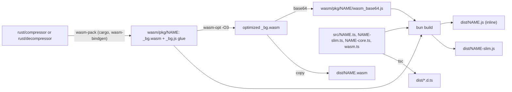

# Architecture: defuss-brotli

defuss-brotli is an npm package with two independent modules, `defuss-brotli/compressor` and `defuss-brotli/decompressor`, each running one WebAssembly binary built from a small Rust wrapper crate around the pure-Rust `brotli` encoder or `brotli-decompressor` decoder. Each module ships in two builds with the same API: the default entry point embeds the binary as base64, and the `/slim` entry point loads it from a separate `.wasm` file (`defuss-brotli/compressor.wasm`, `defuss-brotli/decompressor.wasm`). The API compresses and decompresses whole in-memory buffers; internally, both modules pass them through WASM memory in fixed chunks. The package offers no streaming API and does not wrap Node's native `zlib`.

## Why this design

**Two crates, two entry points.** The encoder needs large static tables that the decoder does not, so one combined binary would make every decode-only browser client download the encoder. Measured on the current build (`make metrics`):

| Module | WASM raw | WASM brotli | inline `dist/NAME.js` raw | inline brotli | `dist/NAME-slim.js` brotli |
|---|---|---|---|---|---|
| compressor | 933,297 B | 392,638 B | 1,249,264 B | 500,472 B | 1,884 B |
| decompressor | 185,531 B | 48,973 B | 252,184 B | 92,957 B | 1,828 B |

The compressor's WASM data section is 648,512 B of static tables and dictionary, of which the encoder's `logs_16` table (65,536 `f32` values) alone is 256 KiB. That is why the compressor is several times larger than the decompressor.

**Inlined base64 by default, a separate `.wasm` on request.** Embedding the binary makes one ESM file that runs unchanged in Node.js and in browsers, with no asset for a bundler or server to place. The cost is size: base64 grows the raw bytes by a third and brotli-compresses worse than the binary, so the inline decompressor is 92,957 B brotli-compressed at quality 11, against 50,801 B for the slim module plus its `.wasm`. Neither cost suits every app, so the package ships both and the developer picks per import. The slim `init()` defaults to `new URL("./NAME.wasm", import.meta.url)` and accepts a URL, a `Response`, bytes or a compiled `WebAssembly.Module` instead. It reads `file:` URLs through `process.getBuiltinModule("node:fs/promises")` rather than an `import("node:fs/promises")`, which bundlers would try to resolve for browser builds. Decoding the base64 at `init()` takes under 1 ms for the compressor (Node 26 and Bun 1.3, measured). `make e2e` installs the packed tarball into clean projects and checks every entry point in Node.js and Bun, and in Chromium from a `bun build` app, a Vite 8.3.6 app (`vite build` and `vite` dev) and an unbundled page that imports the package from a second, CORS-enabled CDN origin through an import map; each browser run fails unless the expected `.wasm` files were fetched. A decompress-only variant of each browser app fails if it bundles or fetches any encoder code.

**One TypeScript source for tests and the published build.** The API of each module lives once in `src/NAME-core.ts`; the entry points `src/NAME.ts` and `src/NAME-slim.ts` only decide where the binary comes from, and `bun build` bundles exactly those files into `dist/`. The Vitest suites therefore run the same initialization and API code that ships, for both builds. The whole glue namespace is the WASM import object (`src/wasm.ts`), so a wasm-bindgen release that renames its import shims needs no build change.

**Fixed chunks in WASM memory instead of whole buffers or `std::io` adapters.** JavaScript drives a WASM `Decoder` or `Encoder` that owns two fixed buffers: it copies each input chunk into one, calls `decode` or `encode`, and copies the produced bytes straight out of the other, then joins the chunks once. Linear memory therefore holds the codec state and two chunks, whatever the payload size. The whole-buffer design it replaces held the input, the state and a doubling output buffer at once; because WASM memory grows but never shrinks, one 100 MiB decode left the instance at 283 MiB for its lifetime, against 19.6 MiB now (`bench/large.mjs`, interleaved with the previous build in one session). Joining 100 MiB from 1 MiB chunks took 7 to 9 ms in Node.js 26 and Bun 1.4, faster than growing a resizable `ArrayBuffer` and fixing its length with `transferToFixedLength()` (14 to 15 ms), which copies as well.

Decoder chunks are at most 1 MiB: on the 100 MiB text, 256 KiB chunks took 161 to 168 ms and 18.1 MiB, 1 MiB chunks 153 to 158 ms and 19.6 MiB, and 4 MiB chunks 148 to 162 ms and 25.6 MiB (three interleaved rounds). Encoder input chunks are exactly one window (`2 ** lgwin` bytes), because qualities 0 and 1 compress each call's input in blocks of at most one window. A `CompressorReader` with a 4 KiB buffer, as in version 0.1.3, makes them encode every 4 KiB chunk as its own fragment, so repeats across chunk boundaries are never found. Measured with Bun 1.3.9 on Apple Silicon (median per call):

| Case | 4 KiB reader (0.1.3) | One window per call |
|---|---|---|
| 28 KiB HTML, quality 1: output size | 3,853 B | 1,189 B |
| 4.9 MB SVG, quality 1: output size | 2,918,088 B | 1,960,828 B |
| 2.1 MB PNG, quality 1: compress time | 15.8 ms | 0.7 ms |

With window-sized chunks the encoder's output is byte-identical to one `BROTLI_OPERATION_FINISH` call over the whole input for every quality (test `chunked_output_matches_one_finish_call`, which fails with 4 KiB chunks). Driving the decoder's state machine directly instead of through `std::io` adapters made its binary 15,793 B smaller before `wasm-opt` than the 0.1.3 version.

**A `no_std` decoder with an arena allocator.** Most apps only decompress, so the decoder is the binary that has to be small. Of its 193,154 B with std, 136,482 B are data, nearly all the 122,784 B static dictionary that RFC 7932 requires of every decoder (30,495 B brotli-compressed). The code splits into `brotli-decompressor` (70 %), std's dlmalloc (14 %), `core::fmt` and panic machinery (8 %) and wasm-bindgen (3 %). On wasm32 the crate is therefore `no_std`, with a panic handler that traps without formatting and a bump allocator that rewinds whenever nothing is live, which it does between calls, once JavaScript has freed the `Decoder`. That took the whole-buffer decoder from 52,950 B to 48,608 B brotli-compressed, where a `no_std` build that keeps dlmalloc reached only 51,364 B; the chunked decoder is 48,973 B. Decoding the 4.9 MB SVG takes 13.0 to 13.7 ms against 12.6 to 15.3 ms for the std build (three runs each, Bun 1.3.9), so the speed difference is within run-to-run noise. Within one stream the arena reuses a freed block only at its top, and blocks freed below it are reclaimed when the `Decoder` is freed; memory still stays bounded, at 19.6 MiB for the 100 MiB text and 19.3 MiB for the 100 MB file of `bench/large.mjs`, both of which span many metablocks. A Vitest case runs 1,100 calls of 4 MiB each, valid, over-limit and truncated, which would exhaust the 4 GiB memory if any path leaked; it traps when the rewind is disabled. Another checks that a 64 MiB output needs no more linear memory than a 4 MiB one.

**`opt-level = 3` and `wasm-opt -O3` instead of size-optimized builds.** Measured against `opt-level = "s"` with `wasm-opt -Oz`, the speed build decompresses the 4.9 MB SVG in 11.5 ms instead of 16.0 ms, and compresses it at quality 1 in 20 ms instead of 31 ms. It costs 1.2 % more brotli-compressed WASM (339,942 B against 336,015 B for the compressor in that measurement). WASM SIMD (`+simd128`) made quality-6 compression slower in the same benchmark, and it would exclude Safari before 16.4, so the build does not enable it.

## How it works

The build turns each Rust crate into an inline module, a slim module and a `.wasm` file:

At runtime, the inline `init()` decodes the base64 string and the slim `init()` reads, fetches or receives the binary, streaming it into `WebAssembly.instantiateStreaming` when the response is `application/wasm`. Both instantiate it with the glue as the import object and hand the instance exports to the glue. `init()` caches its promise, so later calls reuse the instance. `compress` and `decompress` then validate options in TypeScript, create a WASM `Encoder` or `Decoder`, copy input chunks into its input buffer and copy each produced chunk out of linear memory, and free the object in a `finally` block, also after an error. The result is a new `Uint8Array` in JavaScript memory.

### Rust crates

`rust/` is a Cargo workspace with two internal crates (`publish = false`), each exposing one `#[wasm_bindgen]` struct whose plain Rust methods the crate's unit tests call directly, plus a `compress` or `decompress` function that drives it as the JavaScript entry points do:

- `defuss_brotli_compressor::Encoder::new(input_len, quality, lgwin)` sets quality, window and a size hint; its input buffer holds one window and its output buffer half the input plus 1 KiB, at most 1 MiB. `encode(len, last)` runs `BROTLI_OPERATION_PROCESS`, or `FINISH` for the last chunk, until the input is consumed or the output buffer is full.
- On wasm32, `defuss_brotli_decompressor` is `no_std`: the decoder allocates through boxed slices (`BoxAlloc`) and `runtime.rs` supplies the global allocator and panic handler.
- `defuss_brotli_decompressor::Decoder::new(input_len, max_output_size)` gives its input buffer the input's size, at most 1 MiB, and its output buffer four times that, between 64 KiB and 1 MiB and at most `max_output_size`. `decode(len, last)` returns an error when the stream needs more output after `max_output_size` bytes, when the last chunk ends early, when bytes follow the end of the stream, and when the stream is corrupt.

## Operations

- **Configuration and policy:** callers set `quality` (0 to 11, default 6), `lgwin` (10 to 24, default 22) and `maxOutputSize` (positive integer, default 64 MiB). `normalizeOptions` validates them in TypeScript, and the Rust functions check the same ranges again. `maxOutputSize` is capped at 2^32 − 1 before it crosses into WASM, because wasm32 `usize` is 32 bits and wasm-bindgen wraps larger numbers.
- **Complexity and resources:** WASM linear memory holds the codec state and two chunks: up to the decoder's window (at most 16 MiB) plus 2 MiB when decoding, and the encoder state for the chosen quality and window plus one window of input and 1 MiB of output when compressing (69 MiB at quality 6, window 22). WASM memory never shrinks, so an instance keeps that size after its largest call. JavaScript memory holds the input, the result and, while a call runs, the copied chunks: up to twice the result. Compression time grows steeply with quality: quality 11 on the 4.9 MB SVG takes seconds where quality 1 takes about 20 ms.
- **Deployment and builds:** the tarball ships only `dist/` (inline modules, slim modules, `.wasm` files, declarations), `README.md` and `LICENSE`. Build tools are pinned: Node.js, Bun, wasm-pack and binaryen in `mise.toml`, Rust in `rust-toolchain.toml`, crates in `rust/Cargo.lock` and npm packages in `bun.lock`. `make verify` runs lint, tests in Node and Chromium, coverage, and e2e runs that install the packed tarball into clean Node.js, Bun, `bun build`, Vite and CDN projects, including the size budgets in `size-budgets.json`. `make bench` checks the 100 MB benchmark against `bench/perf-budgets.json`; it is not part of `make verify`, because timings depend on the machine.

## Security and privacy

The attack surface is the bytes passed to `decompress`, which callers often receive from the network. `maxOutputSize` bounds the decompressed output, so a small input cannot expand without limit. Truncated, corrupt or trailing-garbage input fails with an error rather than returning partial data. The compressor crate forbids `unsafe` code; the decompressor crate denies it everywhere except `runtime.rs`, its wasm32 allocator and panic handler. Every expected failure reaches JavaScript as an `Error` with a message. The inline modules read no files and open no network connections. A slim `init()` reads or fetches only the `.wasm` location it is given, by default the file next to its module; that binary runs as code with the page's or process's privileges, so it must come from a source as trusted as the JavaScript itself (the same origin, or a pinned CDN URL with integrity checks done by the caller). The package keeps no state between calls beyond the WASM instance and holds no secrets. It processes no personal data of its own. Data the caller passes in is copied through WASM memory, and the allocators do not clear freed buffers, so fragments of the last payload stay in the instance's linear memory until a later call overwrites them (VERIFIED: a decoded marker string is still there after `decompressText` returns). Only code that holds the instance can read that memory.
